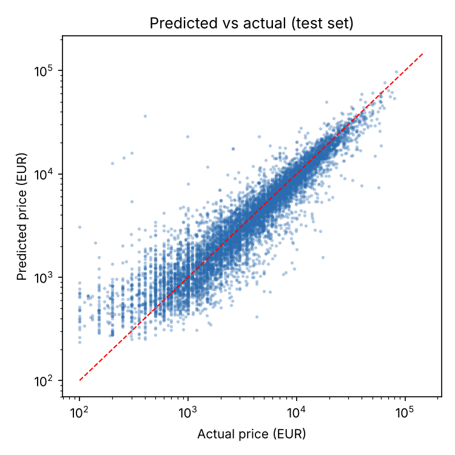
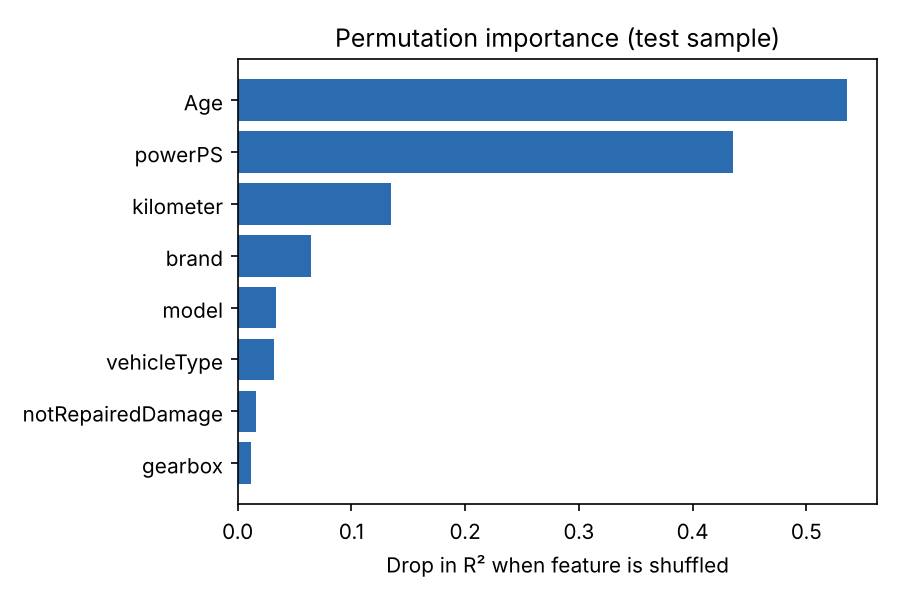

# 🚗 OptiCar: Used Car Price Prediction

[](https://github.com/debmallardasgupta/OptiCar/actions)


An end-to-end machine learning project that predicts the resale price of used cars from ~41k real listings, packaged as an installable Python library with a command-line interface.

> **NPTEL capstone.** Built as the final project for the NPTEL course *Python for Data Science* (IIT Madras), which supplied the dataset and the task. The notebooks are the original course-style analysis; the `opticar` package, model comparison and tuning, CLI, tests and CI were added on top of it.

```console
$ opticar predict --brand bmw --model 3er --age 10 --power 150 --km 150000 --fuel diesel
Estimated price: EUR 6,619
Likely range (80% of held-out cases): EUR 3,998 - 10,525
Note: trained on 2016 listings; prices reflect that market.
```

## Results

Held-out test set (20%, 8,230 listings), final model trained on 32,917 listings. Prices are modelled in log space and converted back, so errors are in euros.

| Model | RMSE (€) | MAE (€) | R² (log price) | Median abs. % error |
| --- | ---: | ---: | ---: | ---: |
| Naive baseline (constant) | 8,057 | 4,612 | 0.000 | 69.5% |
| Linear Regression | 6,698 | 2,456 | 0.703 | 33.1% |
| Random Forest | 2,829 | 1,423 | 0.840 | 21.7% |
| Gradient Boosting | 2,689 | 1,361 | 0.852 | 21.0% |
| **Gradient Boosting (tuned)** | **2,668** | **1,340** | **0.854** | **20.6%** |

- The best model explains **87.5% of the variance in euro price** (R² = 0.875).
- The model was picked by 3-fold cross-validation on the training split only; the test set was used once, for reporting.
- Linear Regression looks much worse in euros than in log space because exponentiating a linear fit amplifies errors on expensive cars.
- Typical error is large (median ≈ 21%). For 80% of held-out cars, the actual price fell between **0.60× and 1.59×** of the prediction, and the CLI reports that band with every estimate.



**What drives price** (permutation importance, drop in R² when a feature is shuffled): vehicle age (0.54), engine power (0.44) and mileage (0.14) dominate. Brand, model and body type matter less. Full table in [`reports/feature_importance.csv`](reports/feature_importance.csv).



## Quick start

```bash
git clone https://github.com/debmallardasgupta/OptiCar.git
cd OptiCar
pip install -e .            # installs the `opticar` command

opticar predict --brand volkswagen --model golf --age 8 --power 105 --km 90000
```

A trained model is committed (`models/opticar.joblib`), so `predict` works immediately. If loading fails because of a scikit-learn version mismatch, retrain it (about 2 minutes on one CPU core): `opticar train`.

### Commands

| Command | What it does |
| --- | --- |
| `opticar train [--tune] [--cv N]` | Clean data, cross-validate 4 models, optionally tune the winner, evaluate on the test split, save the pipeline, metrics and plots |
| `opticar predict --brand … --model … --age … --power … --km …` | Price estimate plus an empirical 80% range. Optional: `--fuel`, `--gearbox`, `--type`, `--damaged yes/no`, `--json` |
| `opticar predict --batch cars.csv --output out.csv` | Score a CSV (needs `Age`, `powerPS`, `kilometer`; other columns optional) |
| `opticar info [--brand audi]` | Model metrics and valid input values, or the models seen for a brand |

Inputs the model has not seen (unknown model name, mileage outside the training range) produce a warning instead of a silent bad estimate. Optional fields you omit are imputed.

## How it works

```
raw CSV ──► clean ──► add Age ──► train/test split ──► Pipeline ──► evaluate ──► save
         (no fitted    (engineered)        │        impute → one-hot → model
          statistics)                      │        (fit on train split only)
                                           └──► 3-fold CV picks the model, test set used once
```

- **Cleaning** drops identifier/noise columns (including `abtest`, an eBay experiment flag), removes duplicates and filters implausible rows (price €100–150k, 10–500 PS, registration 1950–2016).
- **Age** is computed from registration year *and* month against the crawl date (March–April 2016). Invalid months (about 10% of rows have month 0) are treated as mid-year.
- **No data leakage:** median/mode imputation and one-hot encoding live inside a scikit-learn `Pipeline`, so they are fit on training data only. Unseen categories are handled at prediction time.
- **One artifact:** the saved file holds the full pipeline (raw columns in, euros out) plus the metadata the CLI uses for input validation.
- **Models compared:** Linear Regression, Random Forest, Gradient Boosting (`HistGradientBoostingRegressor`) and a constant baseline. The winner is tuned with `RandomizedSearchCV`.

## Project structure

```
opticar/            # installable package
├── config.py       # paths, column groups, cleaning bounds
├── data.py         # loading, cleaning, Age feature
├── modeling.py     # preprocessing pipeline, models, metrics
├── training.py     # CV selection, tuning, evaluation, persistence, plots
├── predict.py      # load artifact, validate input, predict
└── cli.py          # `opticar train | predict | info`
tests/              # pytest suite (data, pipeline, CLI)
models/             # trained pipeline (opticar.joblib)
reports/            # metrics.json, feature importance, plots
notebooks/          # original course-style analysis (EDA + first modelling pass)
data/raw/           # source listings (data/processed is used by the notebooks)
.github/workflows/  # CI: tests on Python 3.10–3.12 + CLI smoke test
```

## Development

```bash
pip install -e ".[dev]"
pytest -q
```

## Limitations

- The data is from **2016 listings of the German used-car market**; predictions reflect 2016 prices and should not be used to value a car today.
- `--age` is the car's age at listing time. Mileage, power and brand/model coverage are limited to what appears in the data.
- The model has no information on condition, options or location, which is why the typical error stays around 20%.

## Dataset

The dataset was provided by the NPTEL course: pre-owned car listings from the **German used-car market** (eBay Kleinanzeigen), crawled in March-April 2016, with prices in euros and engine power in PS (metric horsepower). It has 50,001 raw rows, reduced to 41,147 after cleaning.

## What is original vs. from the course

| From the course | Added in this repository |
| --- | --- |
| Dataset and the price-prediction task | Cleaning rules, `Age` feature fix and leakage-free `Pipeline` |
| Starting notebooks (EDA, first Linear Regression / Random Forest pass) | Cross-validated comparison with Gradient Boosting and hyper-parameter tuning |
| | Installable package, `train` / `predict` / `info` CLI, batch scoring |
| | pytest suite, GitHub Actions CI, metrics and plots in `reports/` |

## Acknowledgements

NPTEL, *Python for Data Science* (IIT Madras), for the dataset and project brief.

## License

MIT, see [LICENSE](LICENSE).
